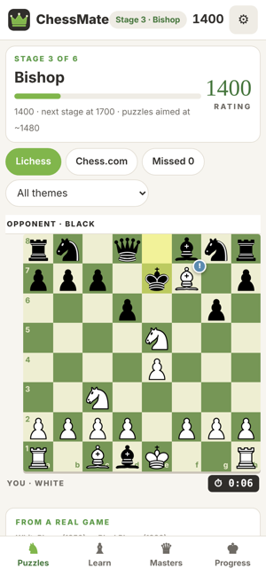
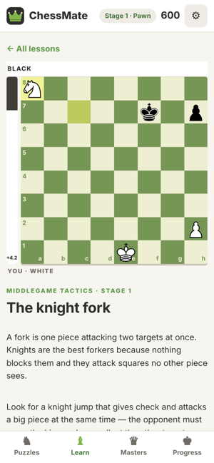
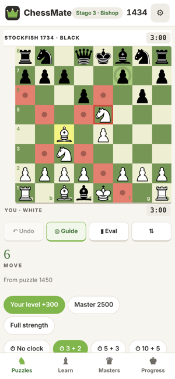

<div align="center">


# ChessMate

**Learn chess through puzzles: from your first fork at 500 to GM-level ideas at 3200+.**

[](https://bibek-cse.github.io/chessmate/)
[](#-install-in-30-seconds)


</div>

<table align="center"><tr>
<td align="center"><br><sub><b>Puzzles</b> from real games</sub></td>
<td align="center"><br><sub><b>Learn</b>: the offline textbook</sub></td>
<td align="center"><br><sub><b>Play</b>: the guide colours safe and danger squares</sub></td>
</tr></table>

<div align="center">

### 📱 Scan to play


**[bibek-cse.github.io/chessmate](https://bibek-cse.github.io/chessmate/)** · no store, no sign-up

</div>

---

## ♛ How it teaches

Every puzzle is a short lesson:

1. **Where it happened:** each Lichess puzzle comes from a real game. You see the players, their ratings and the time control, and can **▶ watch the last 10 moves** that led to the position.
2. **You solve it:** every move you play is **checked by the engine**. It shows Best / Good / Mistake / Blunder, the evaluation, and what the opponent would reply.
3. **The idea:** a textbook note explains the theme (fork, deflection, zugzwang…) and links to the full lesson.
4. **Other options:** the engine shows the **top 4 moves** in the starting position, with lines you can tap to watch on the board.
5. **Play it out:** continue from the puzzle against Stockfish. Every move is analysed again, and you get an accuracy score at the end.

## 🎯 On-board coach (like chess.com)

- **Move icons on the board:** each move gets a badge on its square:
  - <b>!!</b> Brilliant (a good sacrifice) · <b>!</b> Great (the only good move) · <b>★</b> Best · 👍 Excellent · ✓ Good · 📖 Book (a known opening line)
  - <b>?!</b> Inaccuracy · <b>?</b> Mistake · <b>??</b> Blunder
- **Safe-square guide:** tap a piece and its target squares turn **green** (safe), **amber** (risky) or **red** (loses material or the game), based on a Stockfish check of every legal move. Your pieces that can be won get a red outline.
- **Clock:** play it out with 3+2, 5+3 or 10+5, or with no clock. The engine has to manage its time too.
- **Undo** takes back your last move together with the engine's reply.
- **Built for phones:** pieces glide between squares, follow your finger when you drag, and each move gives a short vibration and click sound.

## ⚡ Four tabs

| | |
|---|---|
| ♞ **Puzzles** | Online from **Lichess** (rated, from real games) and **Chess.com** (puzzle archive), saved for offline. Theme filter, plus puzzles from master and super-GM games. A **Missed** list for retries. |
| ♝ **Learn** | An **offline textbook**: Opening, Middlegame tactics, Endgame, Strategy. 17 lessons, each with a position to solve. The engine accepts *any* good move, not only one. |
| ♛ **Masters** | **6 classic games** offline (Opera Game, Immortal, Evergreen, Game of the Century…). Online, you can load **elite events** (Lichess broadcasts) and **recent Chess.com GM games**. Replay a game with engine notes, play **Guess the move**, or press **Play from here**. |
| ♚ **Progress** | A **6-stage ladder**: Pawn 500 → Knight → Bishop → Rook → Queen → **King · GM 2500+**. Rating graph, strengths, weak themes with one-tap *Lesson* / *Train*, and your record against Stockfish. |

## 📈 The stage ladder

| Stage | Name | Rating | Typical puzzles |
|:-:|---|---|---|
| 1 | Pawn | 500–899 | Hanging pieces, mate in 1, simple forks |
| 2 | Knight | 900–1299 | Pins, skewers, mate in 2 |
| 3 | Bishop | 1300–1699 | Discovered attacks, deflection, basic endgames |
| 4 | Rook | 1700–2099 | Quiet moves, sacrifices, rook endgames |
| 5 | Queen | 2100–2499 | Long calculation, defence, zugzwang |
| 6 | King · GM | 2500+ | Master-game combinations, deep lines |

Each new puzzle is aimed **just above your rating**. Three correct in a row raises the challenge, and a miss lowers it. Your rating moves after every rated puzzle, so you climb or drop stages automatically.

## 📲 Install in 30 seconds

| Android (Chrome) | iPhone / iPad (Safari) | Desktop |
|---|---|---|
| Scan the QR code | Scan the QR code | Open the link |
| ⚙ → **Install app on this phone** | Share → **Add to Home Screen** | Install icon in the address bar |
| ⚙ → **Save app + 30 puzzles for offline** | Same | Same |

## 🔌 Online + offline

| Works offline | Needs internet (then cached) |
|---|---|
| Lessons, classic games, saved puzzles, Stockfish on your phone, your progress | New puzzles, elite events, Chess.com GM games, Lichess cloud analysis |

By default, analysis asks the **Lichess cloud** first (it costs your phone almost nothing). If the position isn't in the cloud, Stockfish runs **on the phone** instead. You can choose *Auto / Cloud / Phone* in ⚙.

## 🛠 Run or host it yourself

```bash
git clone https://github.com/bibek-cse/chessmate.git
cd chessmate
python3 -m http.server 8080        # open http://localhost:8080
```

No build step and no framework. To host it free, see **[GITHUB_UPLOAD.md](GITHUB_UPLOAD.md)**.

<details><summary><b>Files</b></summary>

| Path | What it does |
|---|---|
| `js/app.js` | The four tabs, puzzle flow, play-it-out, settings |
| `js/puzzles.js` | Lichess + Chess.com fetch, offline queue, stages, rating |
| `js/lessons.js` | The textbook (17 engine-checked lessons) |
| `js/classics.js` | 6 classic games (each checked move by move) |
| `js/engine.js` | Lichess cloud eval → Stockfish on the phone |
| `js/util.js`, `js/game.js` | Move icons (brilliant … blunder), safety checks, game analysis, PGN |
| `js/book.js` | Offline opening book (45 main lines) for 📖 book moves |
| `js/board.js`, `js/chess.js` | Animated touch board: drag, badges, guide colours; chess rules |
| `engine/` | Stockfish 19 lite (WebAssembly) |
| `sw.js`, `manifest.webmanifest` | Offline cache, install |

</details>

<details><summary><b>Good to know</b></summary>

- Without a Lichess login, puzzles above about 2400 are rarer. The app keeps downloading and serves the closest it has.
- Chess.com puzzles have no rating, so they are unrated practice.
- Lichess allows one request at a time. If it says "slow down", the app waits a minute.
- Stockfish runs in its *lite* build so phones stay cool. It is still far stronger than any human.
- Progress is stored only on your device. There are no accounts and no tracking.

</details>

## 🙏 Credits

Puzzles: [Lichess database](https://database.lichess.org/#puzzles) (CC0) and the [Chess.com public API](https://www.chess.com/news/view/published-data-api) · Engine: [Stockfish](https://github.com/official-stockfish/Stockfish) (GPLv3) via [stockfish.js](https://github.com/nmrugg/stockfish.js) · Rules: [chess.js](https://github.com/jhlywa/chess.js) (BSD-2) · Pieces: cburnett (CC BY-SA 3.0). Lessons were written for this app. Classic game scores are public domain.

<div align="center"><br><br><b>Made by <a href="https://github.com/bibek-cse">Bibek</a></b>. If a puzzle beat you, ⭐ the repo and try again.</div>
