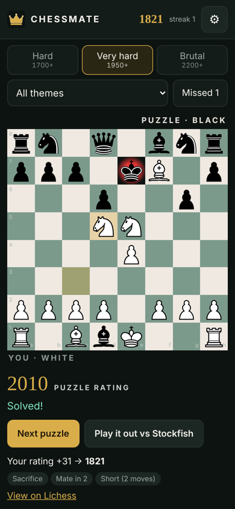

<div align="center">


# ChessMate Puzzles

**Hard chess puzzles in your pocket. No ads, no account, no mercy.**

[](https://bibek-cse.github.io/chessmate/)
[](#-install-in-30-seconds)


</div>

<table align="center">
<tr>
<td align="center" width="50%">

</td>
<td align="center" width="50%">

### 📱 Scan to play


**[bibek-cse.github.io/chessmate](https://bibek-cse.github.io/chessmate/)**

Point your phone camera at the code.<br>
The app opens straight away, with no store and no sign-up.

</td>
</tr>
</table>

---

## ♛ The idea

Most puzzle apps keep you comfortable. **ChessMate keeps you uncomfortable**:

- every puzzle is rated **1700 or higher**;
- each new puzzle is picked **just above your current rating**;
- after you solve one, you can **play the position to the end against Stockfish at full strength**.

> *Find the move. Then defend it against an engine that doesn't blink.*

## ⚡ Features

<table>
<tr>
<td width="50%" valign="top">

**👑 Three levels**<br>
Hard **1700+** · Very hard **1950+** · Brutal **2200+**

**🎯 Tricky themes**<br>
Sacrifice · quiet move · defence · in-between move · zugzwang · deflection · X-ray · mate in 3/4/5+ · long lines · endgames

**⚔️ Play it out**<br>
Take any puzzle into a full game against Stockfish 19. Choose 1, 2 or 4 seconds per move. No hints, no take-backs.

</td>
<td width="50%" valign="top">

**🔁 Missed list**<br>
Every puzzle you fail waits for you until you solve it.

**💡 Hints that cost you**<br>
Theme → piece to move (now unrated) → arrow.

**📈 Live rating**<br>
Your rating moves after every puzzle. Track your best streak and your wins and losses against Stockfish.

**📴 Offline ready**<br>
15 puzzles are always saved on your phone and refill whenever you're online.

</td>
</tr>
</table>

## 🎮 How a round works

| Step | What happens |
|:-:|---|
| **1** | The opponent's move plays on the board. Watch it. |
| **2** | Find the best reply. A wrong move counts as a miss. |
| **3** | The opponent defends. Keep finding the right moves. |
| **4** | Solved? **Next puzzle**, or **Play it out vs Stockfish**. |

## 📲 Install in 30 seconds

| Android (Chrome) | iPhone / iPad (Safari) | Desktop (Chrome / Edge) |
|---|---|---|
| Scan the QR code or open the link | Scan the QR code or open the link | Open the link |
| Tap **⚙** → **Install app on this phone** | Tap **Share** → **Add to Home Screen** | Click the **install icon** in the address bar |
| Open it once online to save puzzles | Open it once online to save puzzles | Done |

The installed app opens full screen with the gold crown icon. Before a flight, tap **⚙ → Download 30 more puzzles**.

## 🛠 Run or host it yourself

No build step, no `npm install`, no framework. These are plain files:

```bash
git clone https://github.com/bibek-cse/chessmate.git
cd chessmate
python3 -m http.server 8080        # then open http://localhost:8080
```

You can host your own copy free on GitHub Pages; see **[GITHUB_UPLOAD.md](GITHUB_UPLOAD.md)**.

<details>
<summary><b>How it's built</b></summary>

```
Lichess puzzle API ──► puzzles saved on your phone ──► board
                                                         │
                      solved? ──► Play it out ──► Stockfish 19 (WebAssembly, background thread)
```

| Path | What it does |
|---|---|
| `index.html`, `css/` | One page, green-and-gold theme, cburnett pieces |
| `js/app.js` | Puzzle flow, online fetch + offline queue, rating, play-it-out |
| `js/board.js` | Touch board: tap or drag, arrows, promotion picker |
| `js/chess.js` | Chess rules (chess.js 1.4) |
| `js/store.js` | Saves progress on the device |
| `engine/` | Stockfish 19 lite (WebAssembly) |
| `sw.js`, `manifest.webmanifest` | Offline cache and install |
| `docs/` | Screenshot and QR code |

</details>

<details>
<summary><b>FAQ</b></summary>

**Why does Brutal sometimes take a moment to load?**
Without a login, Lichess pitches puzzles at an average player. The app downloads more in the background and keeps only the 2200+ ones.

**Is Stockfish really full strength on a phone?**
It's the "lite" build of Stockfish 19, chosen so phones stay cool. At full strength it is still far stronger than any human.

**Where is my progress stored?**
Only on your device. There are no accounts and no tracking. Resetting is in ⚙.

**Why do I see "too many requests"?**
Lichess allows one request at a time. The app waits a minute and tries again.

</details>

## 🙏 Credits

Puzzles: [Lichess open database](https://database.lichess.org/#puzzles) (CC0) · Engine: [Stockfish](https://github.com/official-stockfish/Stockfish) (GPLv3, via [stockfish.js](https://github.com/nmrugg/stockfish.js); licence in `engine/`) · Rules: [chess.js](https://github.com/jhlywa/chess.js) (BSD-2) · Pieces: cburnett (CC BY-SA 3.0)

<div align="center">

<br>


**Made by [Bibek](https://github.com/bibek-cse)**. If a puzzle beat you, ⭐ the repo and try again.

</div>
